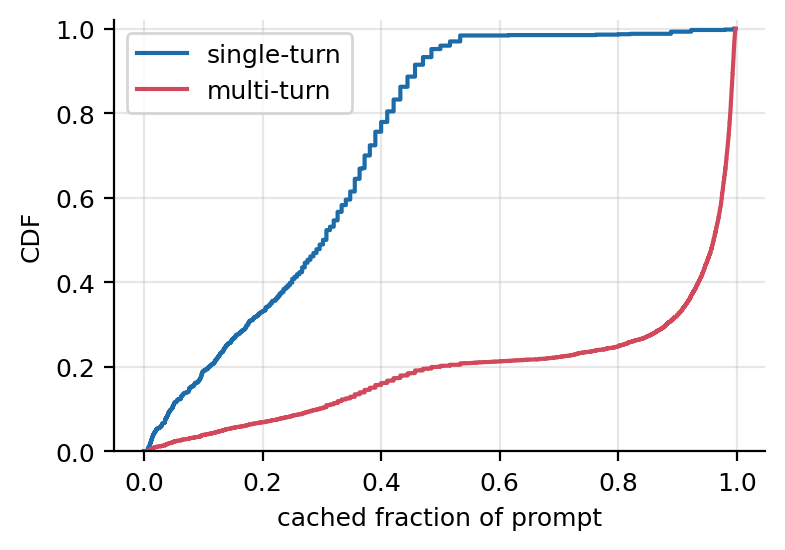
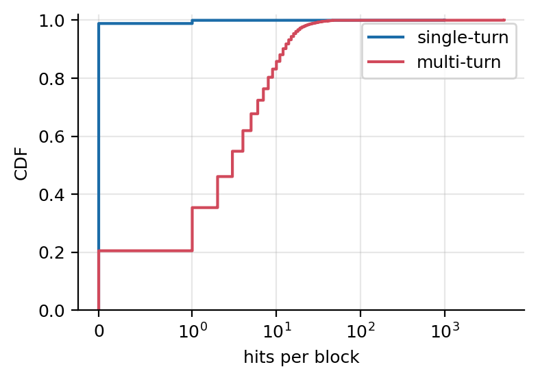
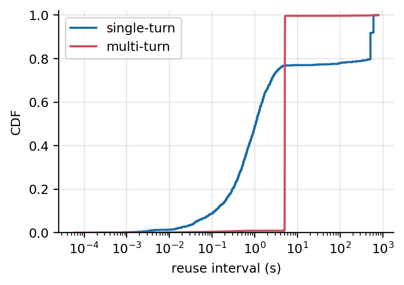
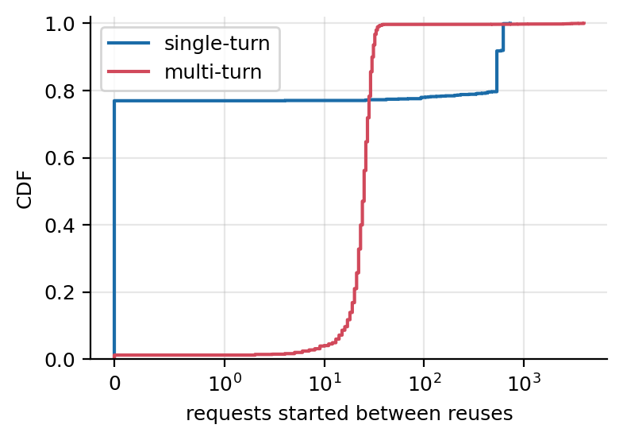
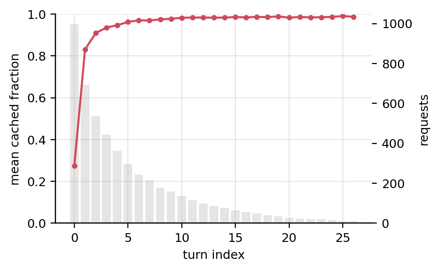
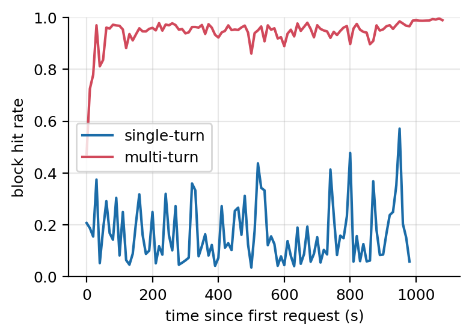
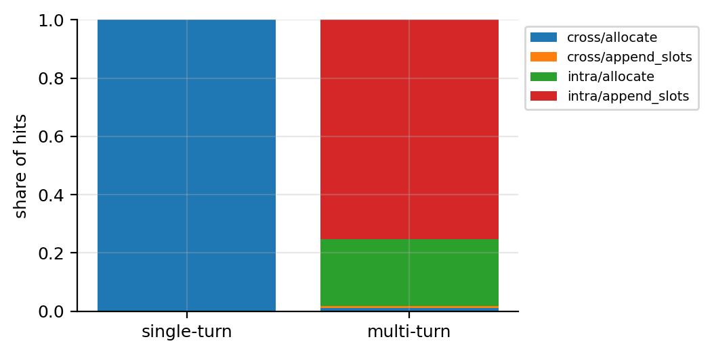

# Milestone 2, Task 2: prefix sharing in single- and multi-turn ShareGPT

**Question.** When ShareGPT is replayed as single-turn (first exchange only)
and as multi-turn (whole conversations), how much of each prompt comes from
the prefix cache, how often is each cached block reused, and how long does
a block wait between reuses? Metric definitions:
[spec 004](../../specs/004-m2-prefix-sharing-analysis/spec.md), metric
table.

**Answer in one line.** Multi-turn conversations reuse their own history:
95% of block lookups hit and 98% of hits are within the same conversation,
three quarters of them on blocks written while generating the previous
answer. Single-turn requests share little (13% of lookups hit), almost all
of it the chat template's system prompt and a few duplicated prompts.

## Setup

- **Sample:** the first 1,000 conversations of the preprocessed ShareGPT
  file: 6,833 turns; 306 conversations have one turn and the longest has
  300.
- **Client:** seed 0, 1 conversation/s (Poisson), think time 5 s, at most 32
  requests in flight.
- **Server:** `Qwen/Qwen2.5-0.5B-Instruct` (config and tokenizer only) on
  the simulator, with `--enable-prefix-caching
  --enable-prompt-tokens-details --max-model-len 8192`. The KV cache is at
  the defaults: 21,845 blocks of 16 tokens (4 GiB) with LRU eviction. Each
  setting starts on a fresh server, so its cache starts empty.
- **Measurement:** the cache event log (`VLLM_CACHE_EVENT_LOG`) together
  with the client's per-request results; the metrics are computed by
  `analysis/metrics.py`.
- **Command:** `python -m analysis.run_m2_task2 --limit 1000 --out
  results/m2-task2`, with `--port 8010` and absolute data paths. It ran on
  2026-10-21 at commit `e6849da8` (clean): 985 s of single-turn replay,
  1,097 s of multi-turn replay, 35 minutes in all. Each setting's
  `run.json` records the full configuration.

Phase 0 and the recorder's overhead are in
[`plan.md`](../../specs/004-m2-prefix-sharing-analysis/plan.md#phase-0-results-2026-10-20).

## Results

Both event logs are complete, and both self-checks pass in both settings:

- **SC-003:** the hit rate counted from the log equals vLLM's own
  `gpu_prefix_cache_hit_rate` (0.12665 and 0.95291; the two agree to
  within 2 × 10⁻¹⁵).
- **SC-004:** every completed request's `cached_tokens` equals 16 × the
  prompt hits logged for it (997 of 997 and 5,097 of 5,097). Conversations
  arrive one per second, so no two requests computed the same block at the
  same time.

| | Single-turn | Multi-turn |
|---|---|---|
| Requests completed | 997 | 5,097 |
| Turns not replayed | 3, too long for the context | 1,736: 60 too long and the 1,671 turns after them, 2 failed and the 3 after them |
| Block lookups | 10,217 | 599,685 |
| **Block hit rate** | **0.127** | **0.953** |
| **Mean cached fraction per request** | **0.280** | **0.807** |
| Cached share of all prompt tokens | 0.121 | 0.949 |
| Distinct blocks cached | 25,587 | 114,964 |
| Blocks with at least one hit | 1.1% | 79.5% |
| Hits per block: median, 90th percentile, max | 0, 0, 996 | 3, 12, 5,097 |
| Reuse interval: median, 90th percentile | 1.1 s, 518 s | 5.06 s, 5.10 s |
| Requests started between reuses: median, 90th percentile | 0, 538 | 25, 31 |
| Evictions (first one at) | 3,743 (834 s) | 94,360 (222 s) |
| Misses on a block evicted earlier | 0 | 627 |
| Time from a block's free to its eviction, median | 802 s | 160 s |
| Hits within the same conversation | 0% | 98.3% |
| Event log | 9.4 MB | 286 MB (2.07 million events, 138 bytes each) |

**Figure 1: cached fraction per request.** 98% of single-turn requests
stay below 0.55, in steps of one block. A fifth of multi-turn requests are
first turns, which look like single-turn ones; 68% are above 0.9.



**Figure 2: hits per block.** 99% of single-turn blocks are never hit;
multi-turn blocks are hit 3 times at the median and 12 at the 90th
percentile.



**Figure 3: reuse interval in seconds.** Multi-turn reuse is a vertical step
at the 5 s think time. Single-turn reuse is spread around the arrival gap
of about 1 s, with two steps near 520 s and 610 s (see below).



**Figure 3b: the same intervals counted in requests.** 25 to 31 requests
start between a multi-turn block's reuses.



**Figure 4: cached fraction by turn (multi-turn).** 0.27 at turn 0, 0.83 at
turn 1, 0.91 at turn 2, above 0.95 from turn 5 and 0.98 to 0.99 from turn
10.
The bars show how many requests reach each turn.



**Figure 5: hit rate over time** (10 s windows). Multi-turn reaches 0.9
within a minute and stays between 0.9 and 1.0, also after evictions start
at 222 s. Single-turn varies between 0.05 and 0.57 around 0.13.



**Figure 6: where hits come from.** Each hit is labelled by the request that
put the block in the cache: the same conversation (intra) or another one
(cross), and a prompt block (`allocate`) or a block of generated tokens
(`append_slots`).



| Hit source | Single-turn | Multi-turn |
|---|---|---|
| Same conversation, generated block | | 75.3% |
| Same conversation, prompt block | | 23.0% |
| Other conversation, prompt block | 100% | 0.95% |
| Other conversation, generated block | | 0.77% |

## Interpretation

1. **Multi-turn sharing is a conversation reusing its own history.** Turn
   k's prompt is turn k−1's prompt plus its answer plus the new question, so
   everything but the new question (and the tail of the last, partly
   filled block) is already cached. That is why the cached fraction jumps
   from 0.27 at turn 0 to 0.83 at turn 1 and approaches 0.99, and why 98.3%
   of hits are within the conversation.
2. **Most reuse is of generated tokens.** Three quarters of multi-turn hits
   are on blocks filled while generating the previous answer. A cache that
   kept only prompt blocks would lose most of the benefit, so eviction
   policies (Task 3) must treat decode-written blocks as first-class.
3. **Single-turn sharing comes from the template and from duplicates.** Of
   its 1,294 hits, 996 (77%) are on one block: Qwen's default system prompt,
   which every request starts with. 260 (20%) come from two pairs of
   conversations with identical long first prompts (157 and 103 blocks),
   which arrive about 520 s and 610 s apart: the two steps in Figure 3. The
   other 38 are shorter repeated openings. The per-request mean (0.28) is
   higher than the per-token share (0.12) because the shared 16-token block
   is a large part of a short prompt.
4. **Cross-conversation sharing in multi-turn is small and comes from the
   dataset.** Besides the system prompt, the 4,386 cross-conversation hits
   on generated blocks come from 8 pairs of conversations: one 30-turn
   conversation appears twice in ShareGPT (3,800 hits), one shares its
   first five exchanges with another (502), and the rest open with "hi" or
   "Hello" and get the same canned answer.
5. **The client sets the reuse timing.** Multi-turn blocks come back after
   the 5 s think time plus a few milliseconds of simulated latency, with 25
   to 31 other requests started in between. Single-turn's system-prompt
   block is reused at the arrival rate, by consecutive requests (0 requests
   in between). Real model latency would stretch these gaps; see
   Limitations.
6. **The default cache is large enough for this workload.** Both settings
   overflow the cache (single-turn only near its end), but eviction costs
   multi-turn just 627 misses, 0.1% of its lookups: a freed block survives
   about 160 s before LRU evicts it, while its conversation comes back after
   5 s. Hits per residency (4.92 on average) are nearly hits per block
   (4.97), so evicted blocks are almost never needed again. To make eviction
   policies differ, Task 3 needs caches small enough that a freed block is
   evicted within the think time.

## Limitations

- **Simulated time.** The simulator computes nothing, so intervals in
  seconds reflect the client's pacing (1 conversation/s, 5 s think time) and
  queueing, not model speed. Figure 3b gives the same intervals in requests,
  which do not depend on speed.
- **Long conversations are trimmed.** The 8,192-token context ended 60
  conversations early and removed 1,731 of 6,833 multi-turn turns (25%),
  the turns with the longest histories, which would have the highest cached
  fractions. See [Task 1](task1-client-simulator.md#what-we-verified).
- **One sample, one seed, one cache size.** Task 3 varies the cache.
- **ShareGPT's duplicates are kept,** since they are in the dataset; they
  account for most cross-conversation sharing beyond the system prompt.
- **Block hashes are only comparable within one run.**

## Reproducing

```bash
python -m analysis.run_m2_task2 --limit 1000 --out results/m2-task2   # about 35 min
python -m analysis.run_m2_task2 --out results/m2-task2 --analyze-only  # metrics and figures again
```

The run folders (event logs, CSVs, `summary.json`) stay in `results/`,
which git ignores; the figures above are copies of
`results/m2-task2/figures/`. The port does not affect the results: the
full run used `--port 8010` because 8000 was busy, and on 2026-10-21 the
documented commands were checked on the default port 8000 (the
20-conversation smoke run passes SC-003 in both settings in 20 s, and the
README's "How to tell the prefix cache worked" gives the values it lists).
