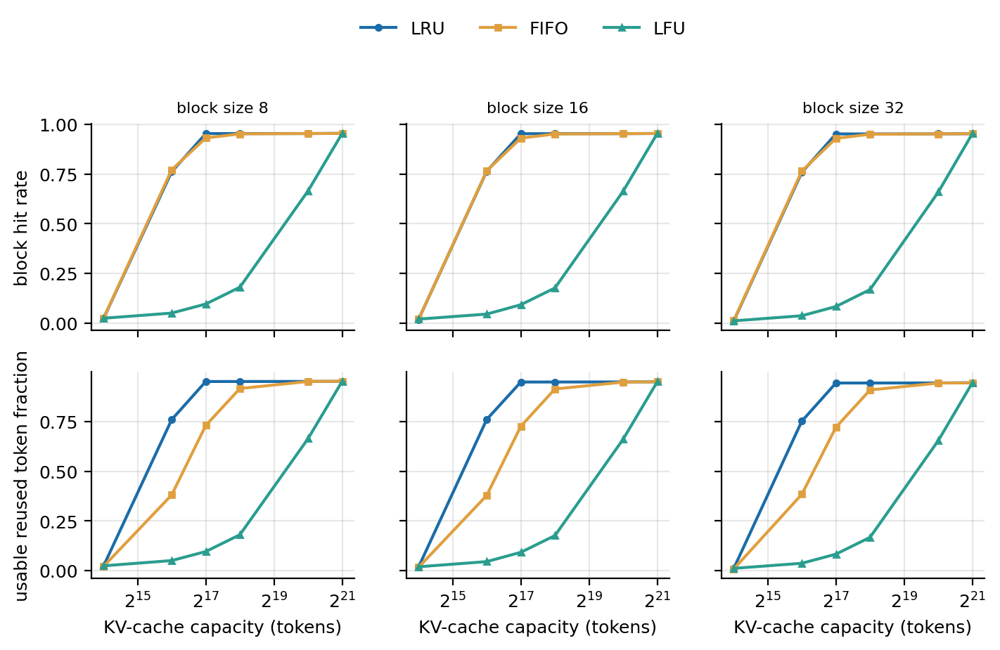
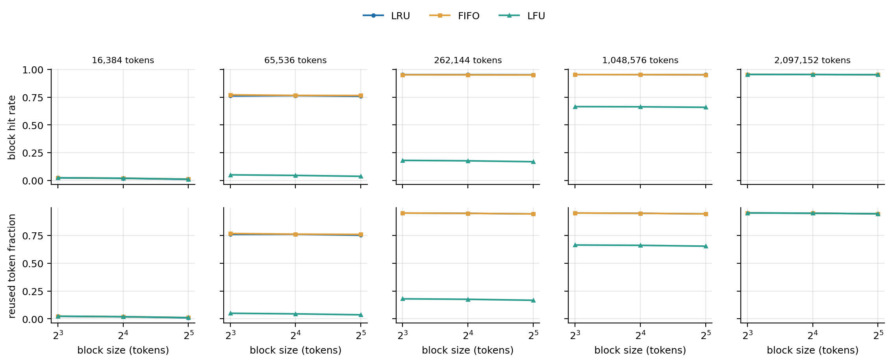
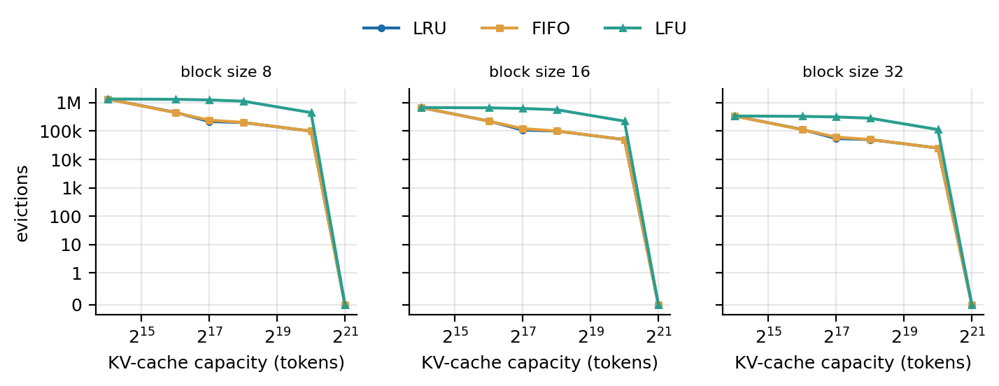
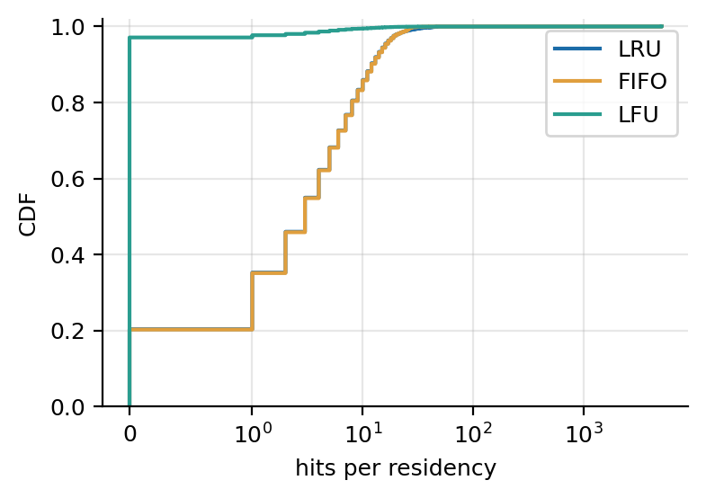
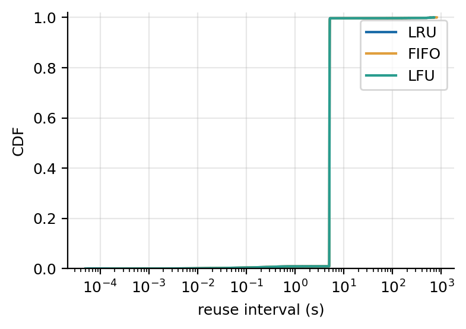

# Milestone 2, Task 3: cache size, block size and eviction policy

**Question.** Which KV-cache capacity, block size and eviction policy (LRU,
LFU, FIFO) give the most prefix sharing on multi-turn ShareGPT, and why?
Full statement, policy definitions (FR-003) and the eviction metrics
(FR-007): [spec 005](../../specs/005-m2-cache-tuning/spec.md). Other
metrics: [spec 004](../../specs/004-m2-prefix-sharing-analysis/spec.md).

**Answer in one line.** Capacity decides almost everything: reuse climbs
from 2% at 16,384 tokens to 95% at 262,144 tokens (14% of the working set)
and stays there. LRU is the policy to use. FIFO matches LRU's hit rate, but
under cache pressure half of its hits sit behind a miss, where vLLM cannot
use them, so it serves half as many prompt tokens from the cache (0.38
against 0.76 at 65,536 tokens). Plain LFU collapses whenever the cache must
evict, because it throws away each conversation's newest blocks before the
conversation returns. Smaller blocks help a little, most for short prompts.

## Setup

- **Sample and pacing:** Task 2's multi-turn setting, unchanged: the first
  1,000 conversations of the preprocessed ShareGPT file (6,833 turns),
  seed 0, 1 conversation/s (Poisson), think time 5 s, at most 32 requests
  in flight; `Qwen/Qwen2.5-0.5B-Instruct` (config and tokenizer only),
  `--enable-prefix-caching --enable-prompt-tokens-details --max-model-len
  8192`. See [Task 2's setup](task2-prefix-sharing-analysis.md#setup).
- **Grid:** 45 configurations, the spec's minimum (SC-003): policies LRU,
  FIFO, LFU × block sizes 8, 16, 32 × capacities 2^14, 2^16, 2^18, 2^20
  and 2^21 tokens (16,384 to 2,097,152). Capacity is fixed in tokens, so a
  configuration has capacity / block size blocks
  (`--num-gpu-blocks-override`). Task 2's run cached 114,964 distinct
  16-token blocks, a working set of 1.84M tokens, so the capacities go from
  about 1% of it to above it. Task 2's default cache, 21,845 blocks of 16
  (349,520 tokens), sits between the third and fourth points.
- **Each configuration** replays the sample on a fresh server (empty cache)
  with `VLLM_EVICTION_POLICY`, `--block-size`, the block count and the
  cache event log set, and is analyzed with Task 2's metrics plus the
  eviction count and rate.
- **Command:** `python -m analysis.run_m2_task3 --grid full --out
  results/m2-task3`. It ran at commit `9f18c4c8` (clean, every run's
  `run.json`) from 2026-10-23 17:10 to 2026-10-24 15:55 UTC; each run
  replays for about 18 minutes, and the rest of the 22.7 hours is time
  the laptop slept (see Limitations). The figures
  and `best_by_capacity` come from the same command at the commit that
  adds this note; it reuses the finished runs.
- **Checks:** all 45 runs finished; in every one vLLM used the requested
  block count, the hit rate counted from the event log equals vLLM's
  `gpu_prefix_cache_hit_rate` (SC-003 of spec 004), and the log is
  complete. Each run completed 5,084 to 5,098 of the sample's requests (the
  rest are over the context limit, or 1 to 2 failed requests and the turns
  after them, as in Task 2).

## Results

Block size 16 (vLLM's default), all capacities. Usable reused fraction is
the share of prompt tokens served from a contiguous cached prefix (block
size × the hits before a request's first miss, summed, over the summed
prompt tokens), the tokens vLLM can skip computing. vLLM's own
`cached_tokens` overcounts this under FIFO (finding 2), so its share is
listed next to it. Under LRU and LFU the two agree in these runs; that
holds at this pacing, not in general (spec 004: under burst load they can
differ in both directions). Mean usable fraction is the per-request mean.
Spec 004 defines all three.

| Capacity (tokens) | Policy | Block hit rate | Usable reused fraction | vLLM `cached_tokens` share | Mean usable fraction | Evictions | Preemptions |
|---|---|---|---|---|---|---|---|
| 16,384 | LRU | 0.018 | 0.018 | 0.018 | 0.078 | 675,098 | 1 |
| | FIFO | 0.019 | 0.016 | 0.019 | 0.078 | 675,570 | 0 |
| | LFU | 0.020 | 0.019 | 0.020 | 0.078 | 675,534 | 2 |
| 65,536 | LRU | 0.764 | 0.761 | 0.761 | 0.666 | 225,893 | 0 |
| | FIFO | 0.766 | **0.378** | 0.762 | 0.485 | 224,591 | 0 |
| | LFU | 0.045 | 0.045 | 0.045 | 0.101 | 657,117 | 0 |
| 262,144 | LRU | 0.953 | 0.949 | 0.949 | 0.807 | 100,062 | 0 |
| | FIFO | 0.951 | **0.914** | 0.949 | 0.797 | 100,989 | 0 |
| | LFU | 0.177 | 0.176 | 0.176 | 0.205 | 565,843 | 0 |
| 1,048,576 | LRU | 0.953 | 0.949 | 0.949 | 0.808 | 50,052 | 0 |
| | FIFO | 0.953 | 0.949 | 0.949 | 0.807 | 50,041 | 0 |
| | LFU | 0.663 | 0.661 | 0.661 | 0.585 | 223,908 | 0 |
| 2,097,152 | all three | 0.954 | 0.950 | 0.950 | 0.809 | 0 | 0 |

**Figure 1: hit rate and usable reused fraction against capacity**, one
panel per block size. LRU and FIFO overlap in hit rate but not in usable
reuse, where FIFO lags at 65,536 and 262,144 tokens; LFU lags until the
cache is large enough never to evict.



**Figure 2: the same against block size**, one panel per capacity. Lines
are nearly flat: at equal capacity in tokens, block size moves the hit rate
by at most 0.013.



**Figure 3: evictions against capacity.** Halving the block size doubles
the number of blocks, so the counts scale with 1 / block size. LFU evicts
2.9 to 5.7 times as often as LRU between 65,536 and 1,048,576 tokens.
Nothing is evicted at 2,097,152 tokens.



**Figure 4: the three policies at 262,144 tokens, block size 16**, the
capacity where they differ most. (a) Hits per residency (insert to evict):
20.3% of LRU's and FIFO's residencies end without a hit, 97.1% of LFU's,
which also has five times as many residencies (582,226 against 116,445).
(b) Reuse interval: the same 5 s step for all three, the client's think
time; a policy changes which blocks survive, not when they come back.




**The best configuration per capacity** (spec item 5, from
`results/m2-task3/best_by_capacity.md`), by usable reused fraction:

| Capacity (tokens) | Best | Usable reused fraction | Next best | Margin |
|---|---|---|---|---|
| 16,384 | LFU, block size 8 | 0.024 | LRU, block size 8 | 0.002 |
| 65,536 | LRU, block size 16 | 0.761 | LRU, block size 8 | 0.001 |
| 262,144 | LRU, block size 8 | 0.952 | LRU, block size 16 | 0.003 |
| 1,048,576 | LRU, block size 8 | 0.952 | FIFO, block size 8 | 0.0002 |
| 2,097,152 | FIFO, block size 8 | 0.953 | LFU, block size 8 | 0 (tie; no evictions) |

At 16,384 tokens every configuration reuses about 2%, so its winner means
nothing; at 2,097,152 nothing is evicted and the policies tie.

## Interpretation

1. **Capacity: a cliff, then a plateau.** Multi-turn reuse needs a
   conversation's history to survive its 5 s think time. At 16,384 tokens
   the cache holds two maximum-length prompts while up to 32 requests are
   in flight, so blocks are evicted before anyone returns and every policy
   reuses about 2%. At 65,536 tokens three quarters of lookups hit, and from
   262,144 tokens (14% of the working set) reuse is within 0.003 of a cache
   that never evicts. The working set is the wrong yardstick: what has to
   fit is the history of the conversations active within one think time,
   not everything the sample ever cached. This explains Task 2's finding
   that its default cache (349,520 tokens) lost only 0.1% of lookups.
2. **FIFO finds blocks as often as LRU but can use only half of them.**
   Their hit rates differ by at most 0.01. But FIFO evicts the blocks that
   first entered the free pool longest ago, which are the beginning of
   each conversation's history, while every later turn reads that history
   again from the start. The next turn then misses on its first blocks and
   hits on the ones after them. vLLM only skips the contiguous cached
   prefix, so hits behind a miss save no compute. At 65,536 tokens, block
   size 16, 50% of FIFO's prompt-lookup hits are behind a miss (in 2,046 of
   5,094 requests; LRU: none), and FIFO serves 0.378 of prompt tokens from
   the cache against 0.761 under LRU. The loss grows with the
   conversation: turns 1 to 4 keep 0.76 under FIFO and 0.74 under LRU,
   turns 5 to 19 0.32 against 0.79. At 262,144 tokens FIFO still loses
   0.035 (0.914 against 0.949); from 1,048,576 tokens it hardly evicts and
   matches LRU. Block sizes 8 and 32 behave the same.

   **vLLM's own `cached_tokens` hides this.** It comes from
   `find_cached_blocks_prefix` (`vllm/core/block/prefix_caching_block.py`),
   a binary search that assumes a cached block's predecessors are cached
   too. LRU keeps that true: a hit refreshes a block and all its
   predecessors, and ties evict the deepest block first. Under FIFO the
   search can land behind a miss, and it overcounted 1,640 requests at
   65,536 tokens (in our runs it never undercounted): vLLM reports 0.762, the same as
   LRU. The scheduler skips that many tokens, which in the simulator only
   inflates the metric; on a GPU it would attend over blocks whose KV was
   never written, so FIFO, or any policy that leaves a miss before cached
   blocks, is not safe on vLLM v0 without a linear scan there. The note's
   first version used `cached_tokens` and called LRU and FIFO
   equivalent; the review of PR #12 (@sahiljoshi515) found the error,
   and the reviewer's independent rerun of the grid gives the same
   picture (FIFO 0.39 against LRU 0.75 at 65,536 tokens).
3. **Plain LFU evicts exactly the blocks multi-turn reuse needs.** A newly
   freed block has zero hits, so LFU evicts it first. At 262,144 tokens,
   99.9% of LFU's evictions are blocks with no hits in that residency,
   evicted a median of 1.5 s after being freed, before their conversation
   returns at 5 s. LRU evicts blocks a median of 113 s after they are
   freed. LFU then misses on blocks it had evicted 466,293 times (LRU: 641)
   and recomputes them, and they are evicted again. Meanwhile blocks that
   collected hits earlier, many from finished conversations, never age
   out: at the end of the run 99.2% of LFU's cached blocks have at least
   one hit. Task 2 found that three quarters of multi-turn hits are on the
   blocks the previous answer wrote, so this is the worst case for
   frequency-based eviction. LFU only catches up when the cache is large
   enough to avoid eviction. (The evictor matches its definition in 41
   unit tests, including a randomized check against a brute-force
   reference, so this is the policy, not a bug.)
4. **Block size: smaller is slightly better.** At equal capacity, block size
   8 beats 32 by at most 0.013 in hit rate but by up to 0.10 in mean cached
   fraction (0.837 against 0.747 at 262,144 tokens with LRU, 0.239 against
   0.138 with LFU). Only full
   blocks are cached, so each prompt's partial last block (on average half a
   block) is always recomputed, which matters most for short prompts. The
   chat template's 24-token system prompt also fills three 8-token blocks
   but no 32-token block. The token-weighted share, dominated by long
   prompts, moves less (0.952 against 0.944).
5. **Recommendation for this workload:** size the cache for the active
   conversations' histories (here about 262,144 tokens), use LRU, and use
   the smallest block size the attention kernels run efficiently with.
   FIFO is worse under pressure and, on vLLM v0, unsafe on a GPU. Plain
   LFU should not be used for multi-turn chat; Milestone 3's
   workload-aware policy (spec 007) should give recently freed blocks a
   grace period or age its frequencies.

## Limitations

- **One sample, one seed.** Differences of about 0.01 are within what a
  rerun can move, most of all inside the cliff: four runs of LRU at
  65,536 tokens, block size 16 (ours and three of the reviewer's) span
  0.749 to 0.765 in usable reuse. FIFO's usable-reuse gap, the LFU gap and
  the capacity cliff are far larger.
- **Pacing is fixed.** Every turn comes back after exactly 5 s, so Figure
  4b is one step. LFU's failure depends on that: blocks are evicted 1.5 s
  after being freed, before the 5 s return. With longer think times or
  heavier load, LRU and FIFO would also lose these blocks, and at lower
  load LFU would lose fewer.
- **Plain LFU only.** No aging or decay; a variant with either is the
  natural next step (spec 005, Risks).
- **LFU counts lookup hits only** (spec 005, FR-002). A block filled during
  decode whose content is already cached is remapped to the cached block
  (a `dedupe` in the event log) without counting as a hit. This is rare
  and does not change the result: at 262,144 tokens, block size 16, LFU
  had 84 dedupes against 565,843 evictions.
- **The cost of small blocks is not modelled.** The simulator computes
  nothing, so block-table size and attention-kernel efficiency, which
  favour larger blocks on a real GPU, do not show up.
- **Capacity is in tokens, not bytes.** Memory per token depends on the
  model (12,288 bytes for Qwen2.5-0.5B); the cliff moves with the number of
  concurrent conversations and their history length, not the model.
- **Long conversations are trimmed** by the 8,192-token context, as in
  Task 2 (25% of turns), which lowers the pressure on large caches.
- **Simulated time pauses during sleep.** The laptop slept several times
  while the grid ran. The client's and the event log's clocks both stop during macOS
  sleep, so the timings in the runs stay consistent; the sleep only
  lengthened the wall-clock time of the grid.

## Reproducing

```bash
python -m analysis.run_m2_task3 --grid smoke --out results/smoke-task3   # 2 min check
python -m analysis.run_m2_task3 --grid full --out results/m2-task3       # 45 runs, about 14 h awake
python -m analysis.run_m2_task3 --grid full --out results/m2-task3 --analyze-only  # metrics, table and figures again
```

The run folders (22 GB of event logs, CSVs and summaries) stay in
`results/`, which git ignores; the figures above are copies of
`results/m2-task3/figures/`. An interrupted grid resumes with the same
command.
