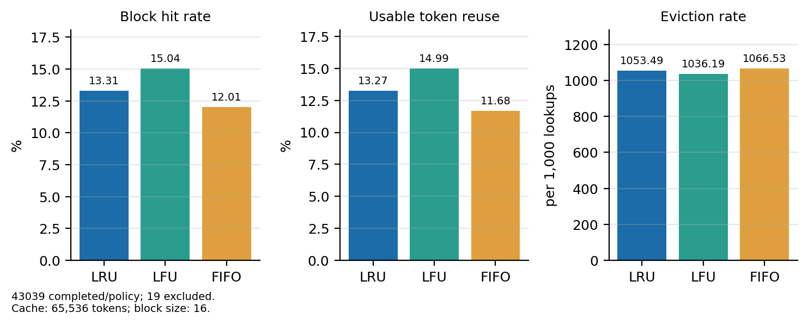
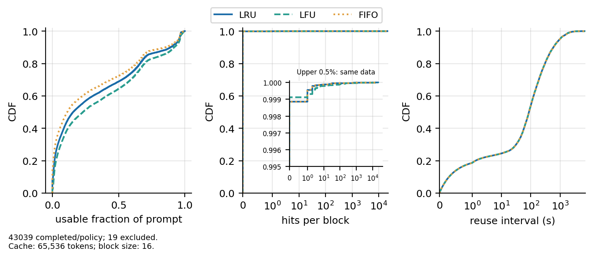
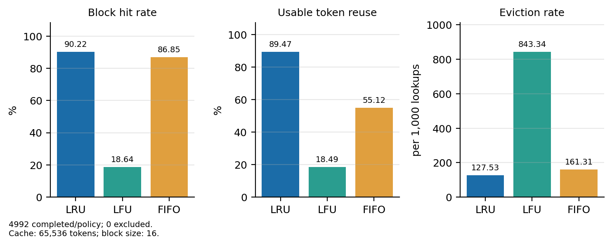
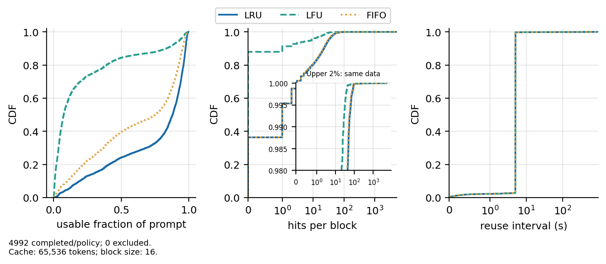
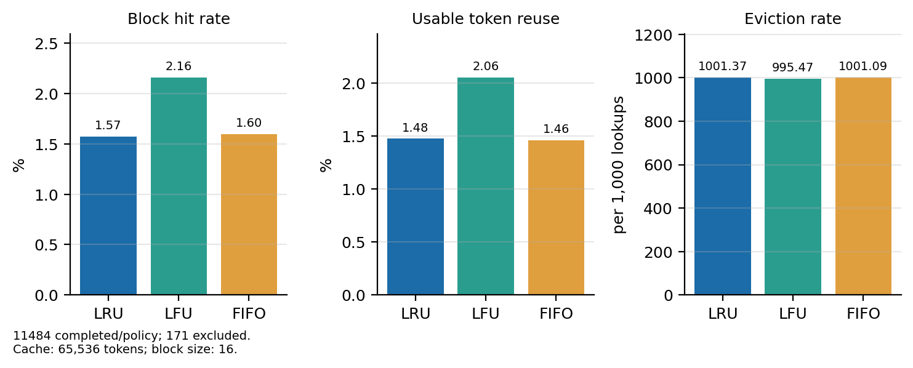
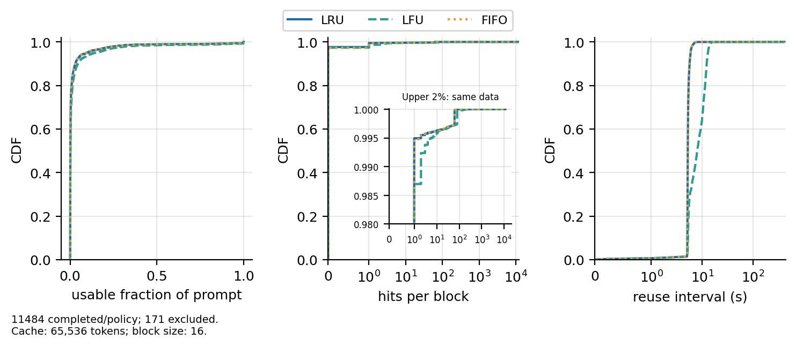

# Milestone 3, Task 1: eviction policies across workloads

Scope and definitions: [spec 006](../../specs/006-m3-workload-eviction/spec.md).

## Setup

```bash
python -m analysis.run_experiment --config examples/bailian_full.json \
  --out results/bailian-full-cap65536
python -m analysis.plot_experiment --out results/bailian-full-cap65536 \
  --figures report/milestone3/figures/task1/bailian-full
```

## Results

| Policy | Block hit rate | Overall usable token reuse | Mean request usable fraction |     Evictions | Evictions / 1,000 lookups |
| ------ | -------------: | -------------------------: | ---------------------------: | ------------: | ------------------------: |
| LRU    |         13.31% |                     13.27% |                       31.52% |     6,512,519 |                  1,053.49 |
| LFU    |     **15.04%** |                 **14.99%** |                   **35.68%** | **6,405,574** |              **1,036.19** |
| FIFO   |         12.01% |                     11.68% |                       28.17% |     6,593,086 |                  1,066.53 |



**Figure 1.** LFU achieves higher hit rate/usable reuse. Eviction rates can
exceed 1,000/1,000 lookups because generated response blocks also consume cache space.

Since overall usable token reuse is the primary ranking factor, LFU makes 14,879,904
input tokens reusable, versus 13,168,784 for LRU and 11,590,176 for FIFO. It has an
advantage of 1.72 percentage points over LRU and 3.32 percentage points over FIFO.

## Reuse profile



**Figure 2.** CDFs of per-request usable fraction (43,039 completed requests), hits
per distinct block (3,770,871 blocks), and reuse intervals (3,568,792 observations)
for each policy.

LFU has 958 zero reuse requests (2.23%), LRU has 3,727 (8.66%) and FIFO has 6,884 (15.99%).
While the mean request reuse is 35.68%, the percentage of token reuse is 14.99%. This is
due to short prompts skewing the percentage up due to them having fewer tokens and reusable
tokens taking up a higher percentage of these prompts. Therefore, this does not necessarily
translate to the same percentage of all prompt tokens being reusable.

Under all three policies LFU, LRU and FIFO, the percentage of block hits of one conversation
that was used in a different conversation are 99.61%, 99.66% and 99.67% respectively. This
differs from the ShareGPT multi-turn analysis, but due to Qwen-Bailian using anonymized hashes,
we do not know the exact content of these matches as they could be instruction prompts shared
between different conversations, explaining the high cross conversation block hit rate.

LFU gets 929,994 hits from 3,317 distinct reused blocks, while LRU gets 823,049 hits from 4,301
blocks. This suggests that LFU keeps the blocks that are repeatedly accessed rather than the most
variety.

About 99.9% of distinct observed blocks have zero hits. This is partly due to Qwen-Bailian only
containing response length rather than their anonymized hash tokens, so our adapter can only create
random and reproducible tokens to fill in the gap. This matters because in a real conversation the
next prompt could contain the response's tokens, reducing the percentage of zero hit blocks. This
percentage therefore describes our synthetic replay rather than the original production workload.

FIFO has 18,096 hits after a miss in 1,259 requests (2.93% of completed requests). These hits contain
289,536 tokens that are not part of a reusable prefix due to FIFO's evicting the oldest blocks and causing
prefix fragmentation. LRU and LFU have no such hits.

Reuse intervals are very similar across all three policies. The median is about 87 seconds and the median gap
is 540 intervening requests.

## Limitations

- Generating synthetic response blocks cannot reproduce all original response-to-next-prompt reuse within conversations
  or cross conversation since our randomly generated response blocks cannot be matched with the correct hash of the next
  input. This affects hit attribution and zero-hit profiles.

## AgentBank

1,000 trajectories, a seeded sample across all 19 subsets, replayed
multi-turn: each agent step is one request with the full history, and the
environment's observations are the user turns
([adapter rules](../../client_simulator/README.md#agentbank-and-cc-bench-agent-trajectories)).
Neither agent dataset records when sessions started, so both use
Milestone 2's ShareGPT pacing: 1 conversation/s (Poisson) and a 5 s think
time. All other settings are the same as Bailian's.

```bash
python -m client_simulator.process_raw_traces --dataset agentbank \
  --raw data/raw/agentbank --seed 0 \
  --output data/processed/agentbank.responses.jsonl \
  --client-output data/processed/agentbank.conversations.jsonl
python -m analysis.run_experiment --config examples/agentbank_1000.json \
  --out results/agentbank-1000-cap65536
python -m analysis.plot_experiment --out results/agentbank-1000-cap65536 \
  --figures report/milestone3/figures/task1/agentbank-1000
```

### Results

| Policy | Block hit rate | Overall usable token reuse | Mean request usable fraction | Evictions | Evictions / 1,000 lookups |
| ------ | -------------: | -------------------------: | ---------------------------: | --------: | ------------------------: |
| LRU    |     **90.22%** |                 **89.47%** |                   **72.92%** | **36,002** |                **127.53** |
| LFU    |         18.64% |                     18.49% |                       21.88% |   238,086 |                    843.34 |
| FIFO   |         86.85% |                     55.12% |                       60.53% |    45,539 |                    161.31 |



**Figure 3.** LRU has the highest hit rate and usable reuse. FIFO's hit
rate is close to LRU's, but its usable reuse is much lower.

All 4,992 requests completed under every policy; none was too long for the
32,768-token context. LRU makes 4,075,376 of 4,554,839 input tokens
reusable, versus 2,510,832 for FIFO and 842,000 for LFU: an advantage of
34.35 percentage points over FIFO and 70.98 over LFU.

### Reuse profile



**Figure 4.** CDFs of per-request usable fraction (4,992 completed
requests), hits per distinct block (39,806 blocks), and reuse intervals
(about 255,000 observations) for each policy.

AgentBank fits in the cache. Sessions are short (median 3 replayed steps,
10 s) and prompts are small (median 460 tokens, p90 2,402), so about 20
sessions with about 18,000 tokens of history are active at once (at most
39,130), well under the 65,536-token cache. Reuse is almost all a
conversation's next step: the median reuse interval is 5.03 s, the think
time, with 25 requests in between, and only 3.0% of LRU's hits come from
another conversation. Those cross-conversation hits are shared task
instructions within a subset, which is why even a conversation's first
request reuses 24.5% of its prompt on average under LRU.

LRU keeps each active conversation's history until its next step. FIFO
evicts the oldest blocks, which are the start of each history, so later
blocks still hit but cannot be used: FIFO has 88,247 hits after a miss in
869 requests (17.41% of completed requests), 1,411,952 tokens that are not
part of a reusable prefix. LRU and LFU have no such hits.

LFU's collapse is cache pollution by stale blocks, the same collapse as in
[Milestone 2 Task 3](../milestone2/task3-cache-tuning.md). Plain LFU never
ages its counts, so blocks of conversations that have already finished
keep the few hits they collected. Replaying each run's event log, blocks of
finished conversations hold on average 89% of the cache under LFU after
the first quarter of the run, against 60% under LRU and 61% under FIFO. A
running conversation's newest blocks have no hits yet, so LFU evicts them
first: 85% of its evictions (202,155 of 238,086) removed a block of a
conversation that was still running, against 21% for FIFO and none for
LRU, which only ever evicted blocks of finished conversations.

These conclusions hold at this load: a 65,536-token cache, 1 conversation/s
and a 5 s think time, about 4,000 prompt tokens/s. In the
[Milestone 3 Task 2](https://github.com/sahiljoshi515/Prefix_Caching_Project/pull/16)
runs (numbers from PR #16's `task2-mixed-workload-policy.md`: a
131,072-token cache, recorded pauses, seeds 2–4), AgentBank alone never evicts, so LRU,
LFU and FIFO all reach 87.3%; in the mix with the other workloads LRU
(76.2%) and LFU (77.6%) tie and FIFO trails (72.1%).

## CC-Bench

All 370 Claude Code sessions (74 tasks, 5 models each), split into 495
conversations: each main thread, sub-agent and post-`/compact` context is
its own conversation. A resumed session logs its earlier history again and
continues; the copies are not replayed, and the new turns extend the
conversation they continue. Tool calls and results are text in the
history. Pacing and settings are the same as AgentBank's.

```bash
python -m client_simulator.process_raw_traces --dataset ccbench \
  --raw data/raw/ccbench/train.parquet --seed 0 \
  --output data/processed/ccbench.responses.jsonl \
  --client-output data/processed/ccbench.conversations.jsonl
python -m analysis.run_experiment --config examples/ccbench_full.json \
  --out results/ccbench-full-cap65536
python -m analysis.plot_experiment --out results/ccbench-full-cap65536 \
  --figures report/milestone3/figures/task1/ccbench-full
```

### Results

| Policy | Block hit rate | Overall usable token reuse | Mean request usable fraction | Evictions | Evictions / 1,000 lookups |
| ------ | -------------: | -------------------------: | ---------------------------: | --------: | ------------------------: |
| LRU    |          1.57% |                      1.48% |                        2.34% | 9,675,479 |                  1,001.37 |
| LFU    |      **2.16%** |                  **2.06%** |                    **3.08%** | **9,619,223** |              **995.47** |
| FIFO   |          1.60% |                      1.46% |                        2.34% | 9,671,589 |                  1,001.09 |



**Figure 5.** Every policy reuses about 2% of input tokens or less. LFU
is ahead by 0.6 percentage points. In every CC-Bench run so far (ours and
the reviewer's, before and after the adapter fixes) LFU was ahead by 0.2
to 0.6 points and LRU's result moved by up to 0.3 points between runs, so
LFU's lead is consistent but small, and no policy recovers useful
reuse.

11,484 requests completed under every policy. 171 turns did not fit in the
32,768-token context, and since a skipped turn ends its conversation,
6,066 later turns were not sent: 35.2% of CC-Bench's 17,721 turns are not
replayed. There were no failures, and 9 (LRU), 12 (LFU) and 8 (FIFO)
preemptions, since one long request takes up to half the cache. LFU makes
3,176,000 of 154,524,769 input tokens reusable, versus 2,280,656 for LRU
and 2,261,280 for FIFO.

### Reuse profile



**Figure 6.** CDFs of per-request usable fraction (11,484 completed
requests), hits per distinct block (615,602 blocks), and reuse intervals
(about 9.2 million observations) for each policy.

At this pacing CC-Bench thrashes the cache under every policy: there is
about one eviction per lookup. Sessions are long (median 18 replayed
turns, 91 s; p90 254 s) and prompts are large (median 12,619 tokens, p90
27,422), so in the LRU run about 50 sessions are active at once (at most
123), with a median of 463,116 tokens of history (at most 1,709,859), 7.1
times the cache. Between two uses of a block (median 5.2 s under LRU and
FIFO, 8.0 s under LFU) come 111 to 122 other requests, so a history is
evicted before its next turn whatever the policy.

Little reuse remains: 97.3% to 97.6% of distinct blocks are never hit,
and the most-hit block, the start of the chat template's system prompt,
is hit by every request. 15.5% to 16.0% of hits come from another
conversation under every policy, so LFU's lead is not shared blocks. It
reuses more of each session's own history: 208,720 hits against 151,731
for LRU, with a longer median reuse interval (8.0 s against 5.2 s), so it
keeps some blocks past the point where LRU has evicted them. FIFO has
4,636 hits after a miss in 71 requests (0.62%), 74,176 tokens that are
not usable.

This ranking holds only at this load. In the
[Milestone 3 Task 2](https://github.com/sahiljoshi515/Prefix_Caching_Project/pull/16)
runs (a 131,072-token cache, recorded pauses, seeds 2–4), CC-Bench reaches
95.4% (LRU), 92.9% (FIFO) and 86.8% (LFU) alone, and 85.2%, 78.3% and
82.4% in the mix: once the histories fit, LRU leads.

### Limitations

- The rate is our choice. Neither agent dataset records session start
  times, so the 1 conversation/s pacing is shared with ShareGPT for
  comparison, not measured. CC-Bench's result describes about 50
  concurrent coding sessions on one 65,536-token cache; with fewer
  concurrent sessions the policies would likely differ more.
- Claude Code's system prompt and tool definitions (about 12,000 tokens per
  session) are not in the logs, so they are not replayed. They would be
  shared by every session and add cross-conversation reuse.
- 35.2% of CC-Bench's turns, the later turns of the longest sessions, are
  not replayed, so its real working set is larger than measured.
- Sub-agents start as independent conversations on the Poisson schedule,
  not at their time inside the parent session. A resumed session's new
  turns follow its earlier ones after the usual think time, not after the
  recorded pause.
- AgentBank's source has a few identical trajectories under different ids
  (13 of the 4,992 replayed requests, 0.3%); they are replayed as the
  dataset has them.
- Responses are replayed from the recordings; AgentBank's agent outputs and
  CC-Bench's model outputs are not generated by Qwen.

## Best policy per workload

| Workload | Best policy | Overall usable token reuse (best / LRU / LFU / FIFO) | Why |
| -------- | ----------- | ---------------------------------------------------- | --- |
| Qwen Bailian | LFU | 14.99% / 13.27% / 14.99% / 11.68% | Recorded traffic shares prefixes across conversations, and LFU keeps the most-shared blocks |
| AgentBank | LRU | 89.47% / 89.47% / 18.49% / 55.12% | Short sessions fit in the cache; LRU keeps each history until its next step |
| CC-Bench | None at this load (LFU slightly ahead) | 2.06% / 1.48% / 2.06% / 1.46% | The working set is about 7 times the cache, so no policy keeps histories; LFU's 0.2–0.6-point lead across runs is too small to matter |

The policy that wins depends on where reuse comes from. When it is a
conversation's own next turn and the active histories fit (AgentBank),
recency is the right signal and LFU is the worst choice. When it is
prefixes shared across conversations (Bailian), frequency wins. When the
active histories far exceed the cache (CC-Bench at this pacing), no policy
recovers much reuse, and the cache size or the number of concurrent
sessions matters more than the policy. These rankings are for one load (a
65,536-token cache at 1 conversation/s). With Task 2's larger cache and
recorded pauses, AgentBank's policies tie when it runs alone and LRU and LFU
tie in the mix, while LRU leads for CC-Bench.
