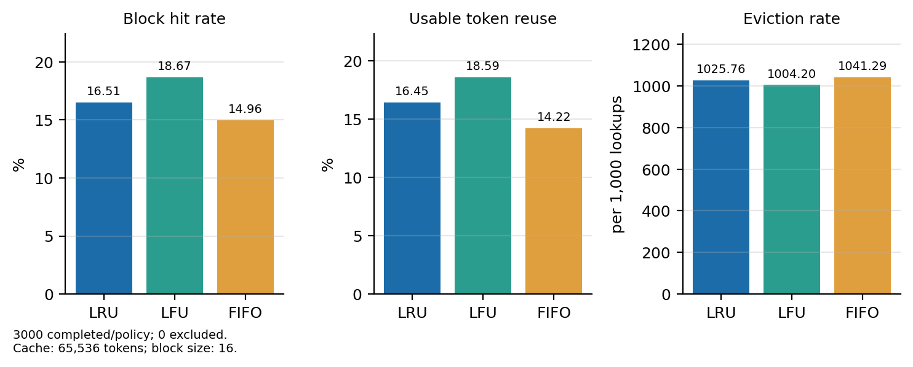
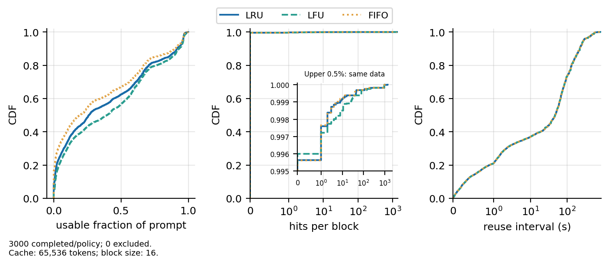

# Milestone 3, Task 1: eviction policies across workloads

The primary Bailian analysis uses 3,000 requests (2026-11-05, Triet
Chau). Scope and definitions:
[spec 006](../../specs/006-m3-workload-eviction/spec.md).

## Setup

```bash
python -m analysis.run_experiment --config examples/bailian_3000.json \
  --out results/bailian-3000-cap65536
python -m analysis.plot_experiment --out results/bailian-3000-cap65536 \
  --figures report/milestone3/figures/task1/bailian-3000
```

## Results

| Policy | Block hit rate | Overall usable token reuse | Mean request usable fraction |   Evictions | Evictions / 1,000 lookups |
| ------ | -------------: | -------------------------: | ---------------------------: | ----------: | ------------------------: |
| LRU    |         16.51% |                     16.45% |                       37.18% |     363,978 |                  1,025.76 |
| LFU    |     **18.67%** |                 **18.59%** |                   **41.13%** | **356,326** |              **1,004.20** |
| FIFO   |         14.96% |                     14.22% |                       32.77% |     369,487 |                  1,041.29 |



**Figure 1.** LFU achieves higher hit rate/usable reuse. Eviction rates can
exceed 1,000/1,000 lookups because generated blocks also consume cache space.

Since overall usable token reuse is the primary ranking factor, LFU
makes 1,059,808 input tokens reusable, versus 937,376 for LRU and
810,688 for FIFO. Its has a 2.15% over LRU and
4.37% over FIFO.

## Reuse profile



**Figure 2.** CDFs of per-request usable fraction (3,000 requests), hits per
distinct block (267,298 blocks), and reuse intervals (159,362 observations) for
each policy.

LFU has 115 zero reuse requests (3.83%), LRU has 271 (9.03%) and
FIFO has 501 (16.70%). While the mean request reuse is 41.13%, the percentage
of token reuse is 18.59%. This is due to short prompts skewing the percentage up
due to them having less tokens and reusable tokens take up a higher percentage of
these prompt. Therefore, this does not necessarily translate to the same percentage of all prompts
tokens being reusable.

Under all three policies LFU, LRU and FIFO, the percentage of block hits of one conversation
that was used in a different conversation are 98.02%, 98.22% and 98.37% respectively.
This differs from the ShareGPT multi-turn analysis's, but due to Qwen-Bailian using anonymized hashes,
we do not know the exact content of these matches as they could be instruction prompts shared between different conversations, explaining the high cross conversation block hit rate.

LFU gets 66,238 hits from 1,069 distinct reused blocks, while LRU gets
58,586 hits from 1,166 blocks. This suggests that LFU keeps the blocks
that are repeatedly accessed rather than the most variety.

About 99.6% of inserted blocks have zero hits. This is partly due to Qwen-Bailian
only containing response length rather than their anonymized hash tokens,
so our adapter can only create random and reproducible tokens to fill in the gap.
This matters because in a real conversation the next prompt could contain the
response's tokens, reducing the percentage of zero hit blocks.

FIFO has **2,409 hits after a miss in 144 requests** (4.8% of requests).
These hits contain 38,544 tokens that are not part of a reusable prefix due
to FIFO's evicting the oldest blocks and causing prefix fragmentations.
LRU and LFU have no such hits.

Reuse intervals are very similar across all three policies. The median is about 47 seconds
and the median gap is 172 intervening requests.

## Limitations

- This analysis only contains 13.8 minute prefix of a 2 hour trace. Running all three policies replays across 3000 requests take ~40 minutes.
- Generating synthetic response blocks cannot reproduce all original response-to-next-prompt-reuse within conversations or cross conversation since our randomly generated response blocks cannot be matched with the correct hash of the next input. This affects hit attribution and zero-hit profiles.
