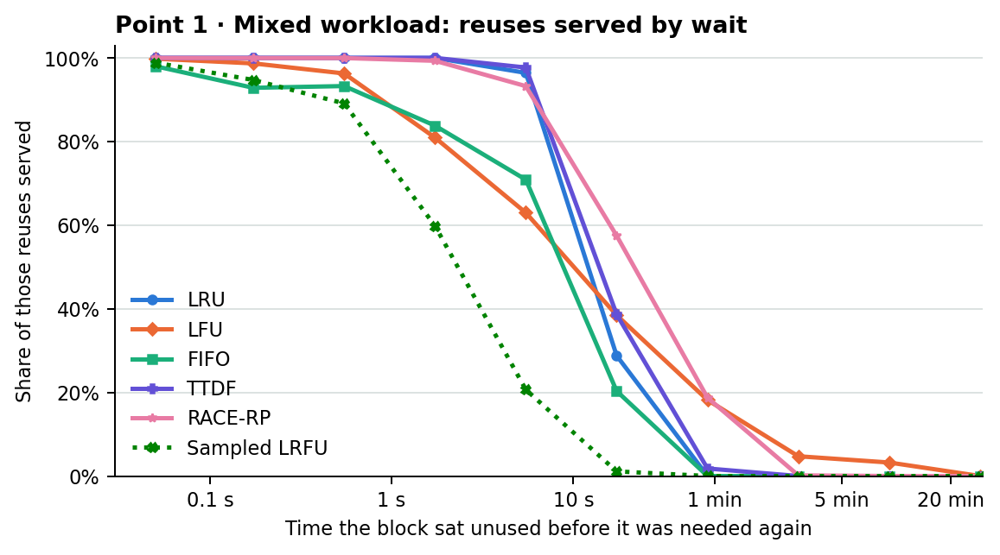
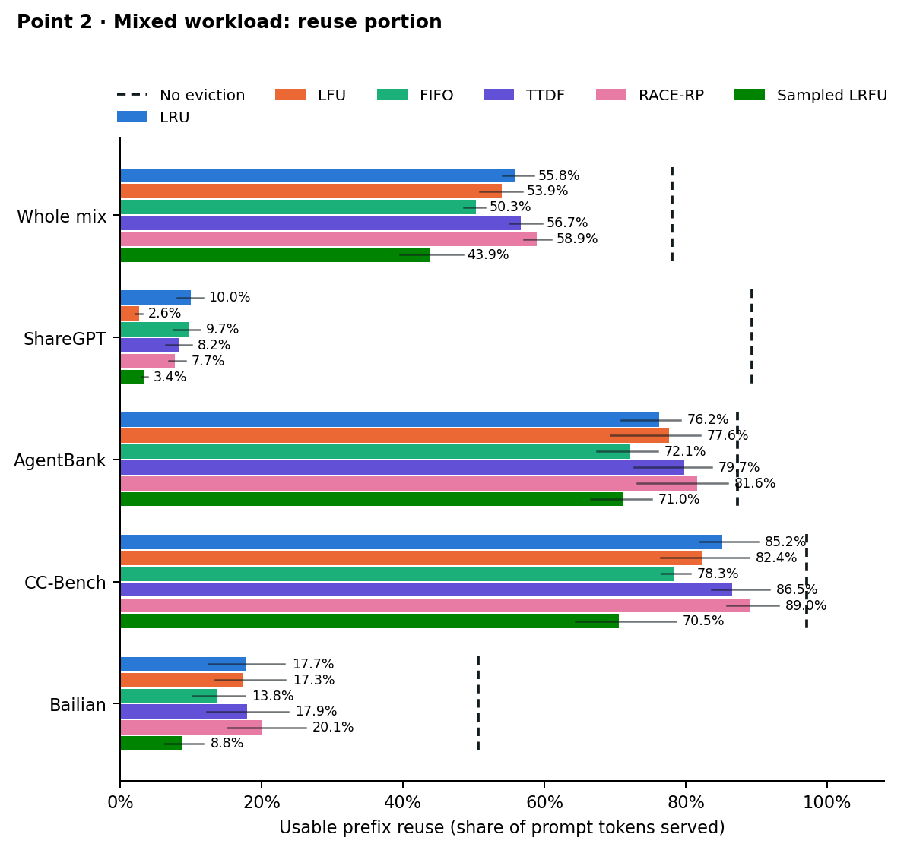
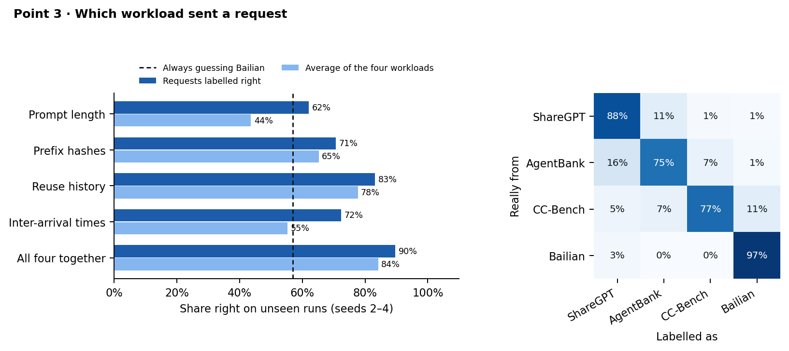
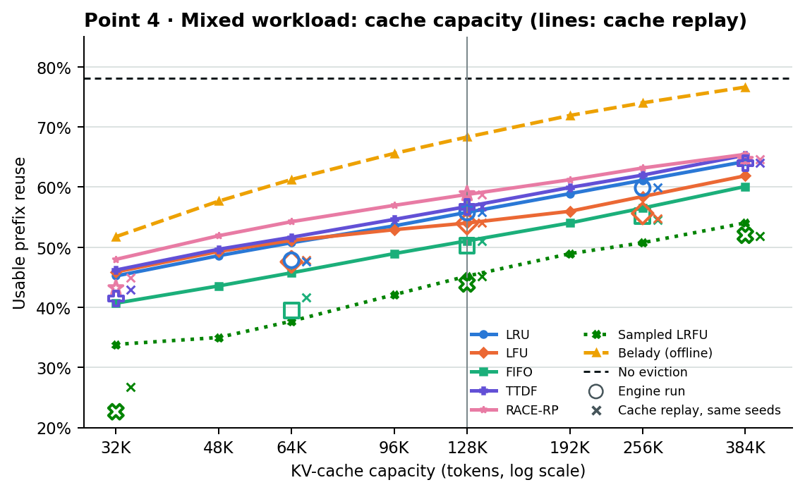
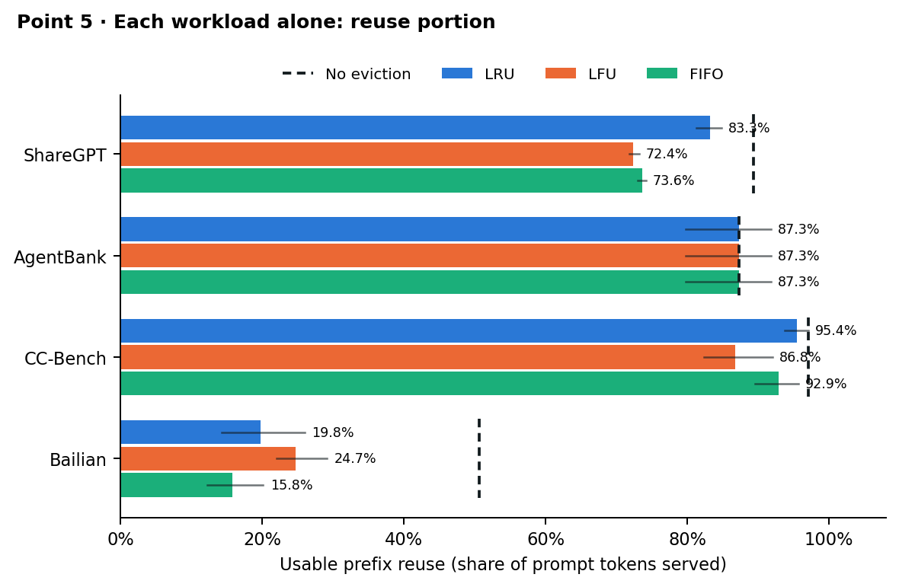
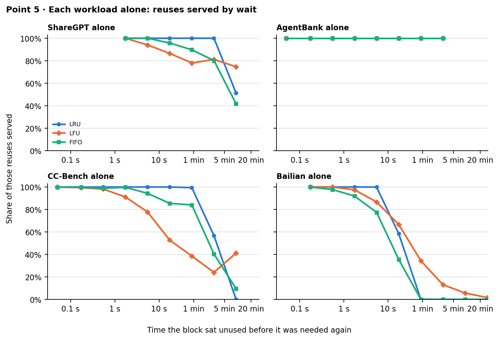
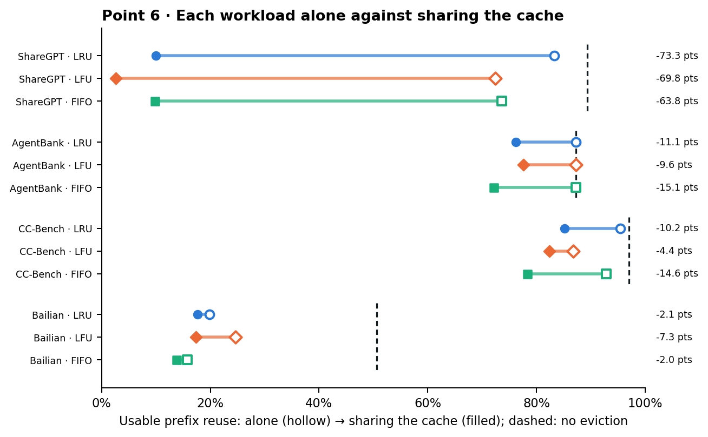
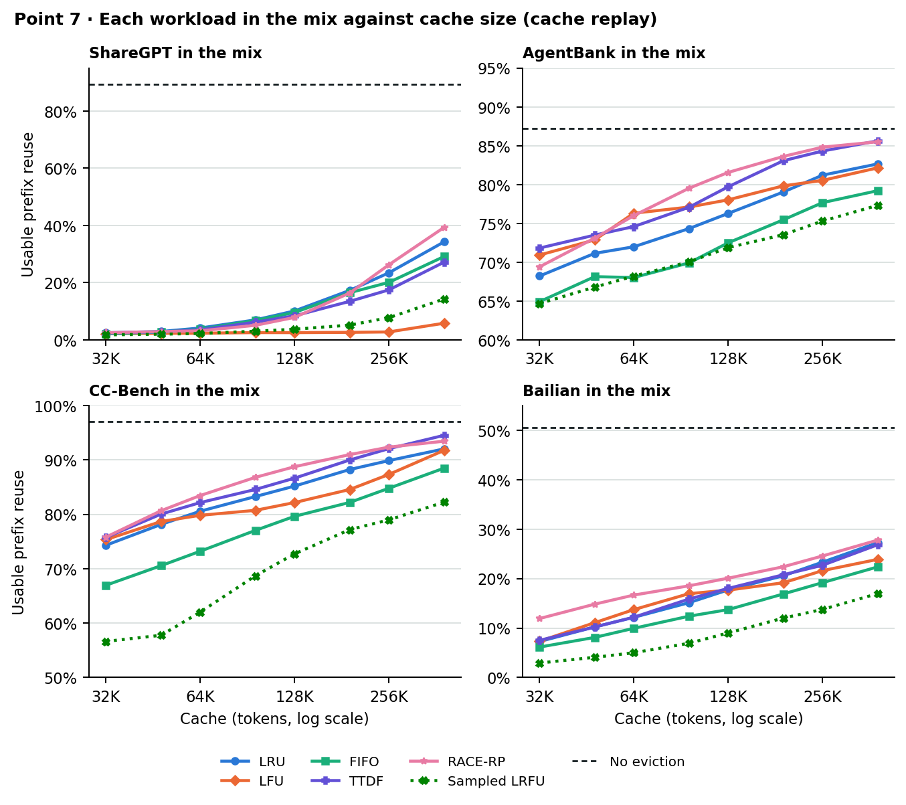
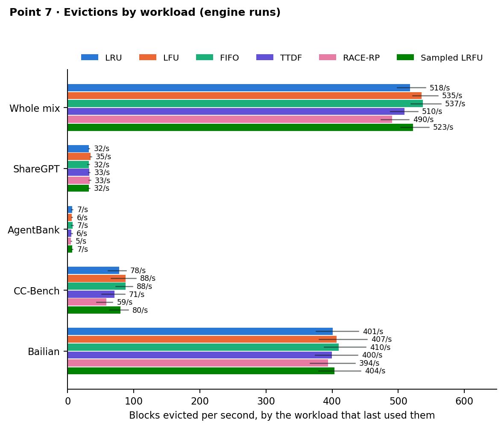

# Milestone 3, Task 2: LRU, LFU and FIFO on a mixed workload

> **Phase 1 (the study and the baselines) done; the policy itself is
> Phase 2.** Owners: Sahil Joshi and Xin Liang Chia (see the
> [spec index](../../specs/README.md)). Branch `milestone3_task2`. The
> plain-language results page with every chart is generated by
> `python -m analysis.m3t2_report`; this note gives the same seven answers
> with the figures from `python -m analysis.m3t2_figures`, and the numbers
> behind them are CSV files in [`data/task2/`](data/task2/)
> (`python -m analysis.m3t2_policies csv`).

**Question.** When four workloads share one KV cache, what do LRU, LFU and
FIFO keep, and can a policy tell the workloads apart? Then: do three new
label-free policies (TTDF, RACE-RP, Sampled LRFU) keep more? Full
statement: [spec 007](../../specs/007-m3-mixed-workload-policy/spec.md).

## Setup

- **Workloads** (4): ShareGPT (people chatting), AgentBank (agent
  trajectories), CC-Bench (a coding agent with tool calls) and Bailian (four
  production traces from `alibaba-edu/qwen-bailian-usagetraces-anon`: chat,
  API, thinking and coder, counted as one workload).
- **Mix.** `analysis/mix.py --mix balanced --pacing human`: 1,800 s plans at
  about 3 requests/s, a seventh of the requests from each of ShareGPT,
  AgentBank, CC-Bench and each Bailian trace; whole sessions; nothing sent
  after the window. ShareGPT borrows bailian-chat's turn gaps, CC-Bench uses
  its own recorded tool latencies, AgentBank samples those; Bailian keeps its
  timestamps (seed k replays each trace's k-th half hour). Requests planned
  in [600, 1800) s are measured.
- **Alone runs.** `analysis/isolate.py` cuts one workload's requests out of
  the balanced plan unchanged (same sessions, prompts, arrival times and
  pauses), so its own traffic intensity is the same alone as in the mix;
  closed-loop turns still wait for replies, so send times can shift by a
  few milliseconds. In the mix the cache also takes the other workloads'
  traffic (about 14,500 prompt tokens/s in all), so point 6 measures the
  effect of that competition as a whole.
- **Engine runs.** `vllm serve` with the simulator executor (the model is
  replaced by a stand-in that returns recorded answers and estimates step
  times, so cache behaviour is vLLM's and timing is an estimate),
  Qwen2.5-0.5B-Instruct, a 131,072-token cache (8,192 blocks of 16 tokens),
  LRU, LFU and FIFO, plus a no-eviction ceiling. Mixed: `grid --grid phase1`
  (commit `01a81876`); alone: `grid --grid isolated`, 36 runs (commit
  `56980db6`). Seeds 2–4 are reported; seed 1 trains the identifier.
- **Cache replay.** `analysis/cachesim.py` replays vLLM's own block-manager
  code on a plan; it is used for the capacity sweep and for Belady
  (`sim --window 600 1800`), and agrees with the 15 engine runs it was
  checked against within 2.1 points.
- **New policies** (mixed workload only; point 7): TTDF and RACE-RP
  (`vllm/core/reuse_evictors.py`) and Sampled LRFU
  (`vllm/core/sampled_lrfu.py`), selected like the baselines with
  `VLLM_EVICTION_POLICY`. Engine runs: `grid --grid policies`, 15 runs
  (each policy at 131,072 tokens on seeds 2–4, and seed 2 at 32K and 384K;
  commits `99092ab7` and `772d396d`). Their settings were tuned on seed 1
  only, in the cache replay; seeds 2–4 ran once with the specified and the
  picked settings. How the code reads each definition:
  [plan](../../specs/007-m3-mixed-workload-policy/plan.md).
- **Rule.** A difference counts only when all three seeds agree on its sign
  and its mean is at least 0.5 points; otherwise it is a tie.

**Usable prefix reuse** is the share of prompt tokens served from the cache,
counting the unbroken run of cached blocks from the start of each prompt
(vLLM's prefix-cache hit rate under LRU, LFU, TTDF and RACE-RP; FIFO and
Sampled LRFU can strand cached blocks behind a missing one, which vLLM's
figure counts and this one does not); **reuse interval** is how long a block sat
unused before it was needed again.

## 1. Reuse time interval (mixed)

Without eviction, 69% of the mix's reuses come back within 10 s (85% of
those are CC-Bench's); of the 31% that wait longer, 59% are Bailian's, 29%
CC-Bench's and 11% ShareGPT's. Blocks another running request still holds
are left out (no policy can evict them).

| Share of reuses served | under 10 s | 10 – 30 s | 30 s – 5 min | over 5 min |
|---|---|---|---|---|
| LRU | 99.5% | 28.8% | 0.0% | 0.0% |
| LFU | 91.8% | 38.5% | 12.0% | 2.9% |
| FIFO | 90.3% | 20.3% | 0.0% | 0.0% |
| TTDF | 99.7% | 38.7% | 1.0% | 0.0% |
| RACE-RP | 99.0% | 57.5% | 10.2% | 0.0% |
| Sampled LRFU | 81.3% | 1.1% | 0.0% | 0.0% |

LRU and FIFO serve nothing that waited more than 30 s; LFU still serves 10%
of those, because a block with many hits outlives a long pause, but it
evicts freshly cached blocks first and so misses more quick reuses. FIFO
serves less than LRU at every wait up to 30 s. Of the new policies,
RACE-RP serves the most of the 10 s – 5 min waits while keeping the quick
reuses; TTDF is LRU-like with a little more at 10–30 s; Sampled LRFU
serves the fewest at every wait.

## 2. Reuse portion (mixed)

| Usable prefix reuse | LRU | LFU | FIFO | TTDF | RACE-RP | Sampled LRFU | No eviction |
|---|---|---|---|---|---|---|---|
| Whole mix | 55.8% | 53.9% | 50.3% | 56.7% | 58.9% | 43.9% | 78.1% |
| ShareGPT | 10.0% | 2.6% | 9.7% | 8.2% | 7.7% | 3.4% | 89.3% |
| AgentBank | 76.2% | 77.6% | 72.1% | 79.7% | 81.6% | 71.0% | 87.3% |
| CC-Bench | 85.2% | 82.4% | 78.3% | 86.5% | 89.0% | 70.5% | 97.1% |
| Bailian | 17.7% | 17.3% | 13.8% | 17.9% | 20.1% | 8.8% | 50.6% |

On the whole mix LFU and FIFO are below LRU on every seed. Of the 22.3
points LRU loses against no eviction, Bailian accounts for 13.1, CC-Bench
6.4, ShareGPT 2.4 and AgentBank 0.3. ShareGPT keeps the smallest part of
what it could: half its reuses wait more than 1.1 min, past LRU's 30 s.
By workload, LFU is below LRU on ShareGPT and CC-Bench (ties elsewhere) and
FIFO below LRU on AgentBank, CC-Bench and Bailian (tie on ShareGPT).
TTDF and RACE-RP are above LRU on the whole mix on every seed: TTDF on
AgentBank and CC-Bench (below on ShareGPT, tie on Bailian), RACE-RP on
AgentBank, CC-Bench and Bailian (tie on ShareGPT). Sampled LRFU is below
LRU on every workload.

## 3. Which workload sent a request

`analysis/identify.py characteristics_report`: one CART tree per signal set,
learned on the labelled seed-1 plan (depth chosen on seed 1 by session
cross-validation), applied online to seeds 2–4 with no labels. The signals
are computed per request from it and earlier requests only: prompt length;
prefix hashes (blocks 1, 2 and 4, looked up in a table learned on seed 1,
cross-fitted for training); reuse history (leading blocks already seen,
inferred parent and turn depth, new tokens, popularity of the 2-block
prefix); inter-arrival times (since the parent, since the last request with
the same 2-block prefix). Each request is labelled on its own.

| Signals | Requests right | Mean of per-workload recall | Prompt tokens right |
|---|---|---|---|
| Always guess Bailian | 57.0% | 25.0% | – |
| Prompt length | 62.0% | 43.6% | 74.6% |
| Prefix hashes | 70.7% | 65.2% | 67.6% |
| Reuse history | 83.2% | 77.7% | 86.2% |
| Inter-arrival times | 72.3% | 55.3% | 65.9% |
| All four | 89.7% | 84.2% | 85.3% |
| All but inter-arrival | 87.1% | 79.1% | 86.5% |

With all four, recall is Bailian 97%, ShareGPT 88%, CC-Bench 77% and
AgentBank 75%; the largest confusions are AgentBank labelled ShareGPT (16%)
and CC-Bench labelled Bailian (11%). ShareGPT, AgentBank and CC-Bench start
with the same system prompt, so their first blocks look alike.

## 4. Cache capacity (mixed, cache replay)

| Cache (tokens) | 32K | 48K | 64K | 96K | 128K | 192K | 256K | 384K |
|---|---|---|---|---|---|---|---|---|
| LRU | 45.2% | 48.6% | 50.7% | 53.5% | 55.8% | 58.9% | 61.1% | 64.2% |
| LFU | 45.9% | 49.3% | 51.1% | 52.9% | 54.0% | 56.0% | 58.4% | 61.9% |
| FIFO | 40.7% | 43.5% | 45.7% | 48.9% | 51.0% | 54.0% | 56.5% | 60.1% |
| TTDF | 46.2% | 49.6% | 51.6% | 54.6% | 56.8% | 59.9% | 62.0% | 65.3% |
| RACE-RP | 48.0% | 51.9% | 54.2% | 57.0% | 58.8% | 61.2% | 63.2% | 65.4% |
| Sampled LRFU | 33.8% | 35.0% | 37.7% | 42.1% | 45.2% | 48.9% | 50.7% | 54.0% |
| Belady | 51.7% | 57.6% | 61.3% | 65.6% | 68.3% | 71.9% | 74.0% | 76.6% |

No eviction: 78.1%. FIFO trails LRU at every size (4.2–5.0 points); LFU
beats LRU only at 32K–48K and trails it at 256K–384K. TTDF and RACE-RP
beat LRU at every size; Sampled LRFU trails it at every size. LRU with
384K tokens (64.2%) serves less than Belady with 128K (68.3%). Engine runs
land within 2.1 points of the replay of the same seeds, except Sampled
LRFU at 32K (seed 2), 4.1 points below: its random draws depend on the
exact order of events, which differs between the engine and the replay.

## 5. Each workload alone

Each workload replayed by itself on the same cache, with exactly the
requests and send times it had in the mix. The ceiling is the mix's: on
average over the seeds at most 0.9% of any workload's no-eviction reuse
came from another workload (1.5% at most on any one seed).

| Usable prefix reuse, alone | LRU | LFU | FIFO | No eviction |
|---|---|---|---|---|
| ShareGPT | 83.3% | 72.4% | 73.6% | 89.3% |
| AgentBank | 87.3% | 87.3% | 87.3% | 87.3% |
| CC-Bench | 95.4% | 86.8% | 92.9% | 97.1% |
| Bailian | 19.8% | 24.7% | 15.8% | 50.6% |

Against LRU: on ShareGPT LFU is 10.9 and FIFO 9.7 points lower; on
AgentBank all three tie (it reaches its ceiling under each); on CC-Bench
LFU is 8.6 and FIFO 2.6 points lower; on Bailian LFU is 4.9 points higher
and FIFO 4.0 points lower.

Alone, LRU keeps serving some reuse at every wait for ShareGPT and
AgentBank, and serves almost nothing past 5 min for CC-Bench and past 30 s
for Bailian (30 s for the mix as a whole).

## 6. Alone against sharing the cache

Same workload, same requests at the same times, same cache: alone, then
sharing with the other three. Requests and prompt tokens per second are
identical in both runs (traffic intensity held fixed); median reply time
under LRU changes by at most about 8 ms (ShareGPT: 33 ms alone, 40 ms
sharing).

| Change when sharing (points) | LRU | LFU | FIFO |
|---|---|---|---|
| ShareGPT | −73.3 | −69.8 | −63.8 |
| AgentBank | −11.1 | −9.6 | −15.1 |
| CC-Bench | −10.2 | −4.4 | −14.6 |
| Bailian | −2.1 | −7.3 | −2.0 |

Sharing lowers usable reuse for every workload under every policy, on
every seed. ShareGPT, whose reuses wait longest (median 1.1 min), loses
almost all of it: under LRU it keeps 93% of its ceiling alone and 11% in
the mix. LFU's lead over LRU on Bailian alone (4.9 points) becomes a tie
in the mix.

## 7. Three new policies on the shared cache

Three label-free policies, run on the mixed workload only:

- **TTDF** (two-timescale decayed frequency): two tallies of each block's
  uses, one fading over 5 s and one over 120 s; the lowest weighted sum
  goes.
- **RACE-RP** (RACE-based reuse probability): five access features per idle
  block (uses in the last 10 s and 120 s, idle time, depth, requests
  sharing its first two blocks) hashed into a RACE sketch learned on seed 1
  (3,639,507 observations); the block whose similar blocks came back least
  (discounted, within 180 s) goes.
- **Sampled LRFU**: one score per block that each use raises by 1 and that
  halves every 512 block uses; the lowest of 4 randomly drawn idle blocks
  goes, in O(1).

TTDF and RACE-RP only evict idle blocks with no cached block after them
in a prompt. Sampled LRFU, as LRU, LFU and FIFO, may evict any idle block.

Cache replay, seeds 2–4. Usable prefix reuse of each workload inside the
mix, at 128K / 384K tokens:

| Workload | LRU | LFU | FIFO | TTDF | RACE-RP | Sampled LRFU | No eviction |
|---|---|---|---|---|---|---|---|
| ShareGPT | 10.1% / 34.3% | 2.6% / 5.8% | 9.6% / 29.1% | 8.4% / 27.2% | 7.9% / 39.3% | 3.7% / 14.3% | 89.3% |
| AgentBank | 76.3% / 82.7% | 78.0% / 82.2% | 72.5% / 79.2% | 79.7% / 85.6% | 81.6% / 85.5% | 71.9% / 77.3% | 87.3% |
| CC-Bench | 85.2% / 92.0% | 82.2% / 91.8% | 79.6% / 88.5% | 86.7% / 94.5% | 88.8% / 93.5% | 72.7% / 82.2% | 97.1% |
| Bailian | 17.7% / 27.3% | 17.7% / 23.9% | 13.7% / 22.4% | 18.0% / 26.8% | 20.1% / 27.8% | 9.0% / 17.0% | 50.6% |

Engine runs at 128K, seeds 2–4: blocks evicted per second, by the workload
whose request used the block last (and the share later looked up again):

| Workload | LRU | LFU | FIFO | TTDF | RACE-RP | Sampled LRFU |
|---|---|---|---|---|---|---|
| ShareGPT | 32 (63%) | 35 (64%) | 32 (63%) | 33 (63%) | 33 (63%) | 32 (63%) |
| AgentBank | 7.0 (40%) | 6.2 (39%) | 7.4 (43%) | 5.9 (30%) | 5.3 (24%) | 6.9 (39%) |
| CC-Bench | 78 (68%) | 88 (76%) | 88 (72%) | 71 (64%) | 59 (59%) | 80 (69%) |
| Bailian | 401 (25%) | 407 (25%) | 410 (27%) | 400 (25%) | 394 (23%) | 404 (25%) |
| Whole mix | 518 (34%) | 535 (36%) | 537 (36%) | 510 (33%) | 491 (30%) | 523 (35%) |

**Which is best, and where each fails.**

- **RACE-RP is best** at every size from 32K to 256K (cache replay) and on
  the engine at 128K (58.9% against LRU's 55.8%, higher on every seed); at
  384K it ties with TTDF. It keeps more of the frequently reused agent
  blocks (AgentBank, CC-Bench) and of Bailian, and evicts the fewest blocks
  that come back. It does not help where reuse is slow: ShareGPT, whose
  turns come back after about a minute, gets 7.7% on the engine (a tie with
  LRU's 10.0% by the rule) and trails LRU at 64K–96K in the replay.
- **TTDF** beats LRU by about a point at every size (56.7% on the engine).
  Its 5 s tally carries 56 times the weight of its 120 s tally (0.7 / 5
  against 0.3 / 120), so it ranks blocks mostly by their uses in the last
  few seconds: it wins on AgentBank and CC-Bench, whose blocks come back
  quickly and often, and loses ShareGPT, whose blocks have no recent uses
  left when they are needed a minute later.
- **Sampled LRFU** trails LRU at every size and on every workload (43.9% on
  the engine). It evicts about as much needed reuse as LRU (736,156 block
  uses against 718,328, seeds 2–4), but because it may draw a block in the
  middle of a prompt, a third of what it loses (364,525 block uses) was
  still cached behind a missing block, where the server cannot use it; 658–733 requests per seed hit such stranded blocks (none under
  the other policies). Drawing 64 blocks instead of 4 makes such a draw
  rarer (seed-1 tuning below).
- **Belady** (offline) is still 9.6 points above RACE-RP at 128K.

| Cost (128K) | LRU | LFU | FIFO | TTDF | RACE-RP | Sampled LRFU |
|---|---|---|---|---|---|---|
| Time per eviction, replay | 1.1 µs | 1.0 µs | 1.2 µs | 4.2 µs | 44.1 µs | 3.2 µs |
| Time per eviction, engine | – | – | – | 6.0 µs | 58.4 µs | 5.6 µs |
| Blocks scored per eviction scan | – | – | – | 38 | 64 | 4 |
| Policy metadata (engine peak) | – | – | – | 448 KiB | 1.8 MiB | 20.4 MiB |

TTDF's metadata is its three counters (192 KiB) and the prefix bookkeeping
both leaf-only policies share (256 KiB); RACE-RP's is mostly its access
history (1.5 MiB; the frozen sketch is 20 KiB). Sampled LRFU's two numbers
per block take 128 KiB; the rest is its record of which blocks the last
4,096 requests counted (the once-per-request rule), which never changed a
count at 128K because no request was preempted there.

**Tuning on seed 1** (cache replay, mean of 32K, 64K, 128K, 256K and 384K;
LRU 51.8%):

| Policy | As specified | Picked on seed 1 | Held out (seeds 2–4), picked against specified |
|---|---|---|---|
| TTDF | τ 5 s / 120 s, w 0.7 / 0.3: 52.9% | w 0.3 / 0.7: 53.0% | higher at 64K, 128K, 256K; tied elsewhere (at most 0.7 points) |
| RACE-RP | L 16, P 6: 53.9% | L 64, P 8: 54.3% | tied at every size (at most 0.3 points) |
| Sampled LRFU | half-life 512, 4 drawn: 40.7% | half-life 4,096, 64 drawn: 51.0% | higher at every size (up to 12.9 points); against LRU, lower at 32K, 48K and 384K and tied from 64K to 256K |

## Limitations

- ShareGPT's and AgentBank's pauses are borrowed from other traces, so their
  reuse intervals are inputs, not measurements; with Phase 0's fixed 5 s
  pauses LRU serves ShareGPT 95% instead of 12% (seed 2).
- The Bailian traces are thinned to fit the mix (each keeps 2–44% of its
  sessions), which removes part of their cross-user reuse; their tokens are
  synthetic, so only their reuse pattern is real.
- CC-Bench lacks the tool definitions real coding agents send, and its 74
  tasks repeat across seeds, which helps the identifier's hash lookups.
- Timing comes from vLLM's CPU simulator; FIFO is the most timing-sensitive
  policy (it moved by up to 7.2 points between loaded and quiet replays).
- Three reported seeds.
- The new policies were tuned on the seed they were trained on (seed 1),
  so the seed-1 picks are optimistic; the held-out seeds were run once.
  RACE-RP's sketch was trained on seed 1's engine timing and is replayed on
  model timing in the capacity sweep. The engine has only the 128K runs on
  three seeds and single seed-2 checks at 32K and 384K.
